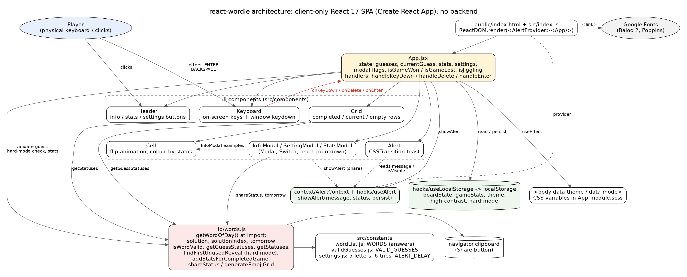

# Architecture

React Wordle is a single-page app built with Create React App (`react-scripts` 5) and React 17. Everything runs in the browser: there is no backend or API, the answer list ships in the JavaScript bundle, and all player state lives in `localStorage`.

The diagram source is [`diagrams/architecture.dot`](diagrams/architecture.dot) (Graphviz). Re-render the PNG and SVG with `docs/diagrams/render.sh` after editing it (needs `graphviz` and `fonts-dejavu`).

## Startup

1. `public/index.html` loads the Baloo 2 and Poppins fonts from Google Fonts and provides `#root`.
2. `src/index.js` renders `<App />` inside `<AlertProvider>` (React `StrictMode`).
3. Importing `src/lib/words.js` runs `getWordOfDay()` once. It counts whole days since a fixed epoch (`new Date(2022, 0)`, local midnight on 1 January 2022) and exports:
   - `solution`: `WORDS[index % WORDS.length]` from `src/constants/wordList.js`,
   - `solutionIndex`: the day number, used as the puzzle number,
   - `tomorrow`: the timestamp of the next rollover, used by the countdown.

Because the word is chosen at import time, a tab left open past the rollover keeps the old puzzle until it is reloaded.

## Components

| Module                                   | Role                                                                                                                                                                                                    |
| ---------------------------------------- | ------------------------------------------------------------------------------------------------------------------------------------------------------------------------------------------------------- |
| `src/App.jsx`                            | Owns all game state (`guesses`, `currentGuess`, `stats`, settings, modal flags, `isGameWon` / `isGameLost`, `isJiggling`) and the input handlers `handleKeyDown`, `handleDelete` and `handleEnter`.     |
| `components/Header`                      | Title and the buttons that open the info, stats and settings modals.                                                                                                                                    |
| `components/Grid`                        | Six rows: submitted guesses (`CompletedRow`, coloured by `getGuessStatuses`), the row being typed (`CurrentRow`, which shakes while `isJiggling`), and empty rows.                                      |
| `components/Cell`                        | One tile. Completed tiles flip in with a 0.35 s delay per position and take the `correct` / `present` / `absent` colour.                                                                                |
| `components/Keyboard`                    | On-screen QWERTY keys coloured by `getStatuses`, plus a `window` `keydown` listener for letters, Enter and Backspace. Both call back into `App`.                                                        |
| `components/Alert`                       | Toast at the top of the page; reads `message`, `status` and `isVisible` from `AlertContext`.                                                                                                            |
| `components/Modal`                       | Shared modal shell with a fade transition; closes on the close button or a click outside (`useOnClickOutside`).                                                                                         |
| `components/InfoModal`                   | "How to play", with example `Cell`s.                                                                                                                                                                    |
| `components/SettingModal`                | Hard mode, dark mode and high-contrast toggles (`components/Switch`).                                                                                                                                   |
| `components/StatsModal`                  | Played, win rate, streaks and guess distribution; after the game ends, a countdown to `tomorrow` (`react-countdown`) and a Share button.                                                                |
| `context/AlertContext`, `hooks/useAlert` | `showAlert(message, status, persist)`; hides the toast after 2 s unless `persist` is set.                                                                                                               |
| `hooks/useLocalStorage`                  | `useState` that reads its initial value from, and writes every update to, `localStorage` as JSON.                                                                                                       |
| `src/constants`                          | `settings.js` (`MAX_WORD_LENGTH` 5, `MAX_CHALLENGES` 6, `ALERT_DELAY` 2000 ms), `wordList.js` (`WORDS`, 5,757 possible answers) and `validGuesses.js` (`VALID_GUESSES`, 12,972 extra accepted guesses). |

## Guess flow

1. A letter (key press or on-screen key) reaches `handleKeyDown`, which appends it to `currentGuess` while it is shorter than 5 letters and the game is not won. Backspace / DELETE calls `handleDelete`.
2. Enter calls `handleEnter`, which rejects the guess (shaking the row and showing an error alert) when:
   - it has fewer than 5 letters ("Not enough letters"),
   - `isWordValid` finds it in neither `WORDS` nor `VALID_GUESSES` ("Not in word list"),
   - hard mode is on and `findFirstUnusedReveal` finds a revealed hint from the previous guess that is not reused ("Must use X in position N" / "Guess must contain X").
3. Otherwise the guess is appended to `guesses`. If it is the solution, or it is the sixth guess, `addStatsForCompletedGame` updates `gameStats` first.
4. An effect on `guesses` persists `boardState` and checks the result: a win shows "Well done", a loss shows the word in a persistent alert, and either opens the stats modal shortly after.

### Scoring

`getGuessStatuses` scores a guess in two passes so duplicate letters are handled like the original game: first it marks exact matches `correct`, then it marks remaining letters `present` only while unmatched copies of that letter are left in the solution, and `absent` otherwise. `getStatuses` folds all guesses into one status per letter for the keyboard, where `correct` is never downgraded.

## Persistence

`useLocalStorage` keeps these keys in the browser's `localStorage`:

| Key             | Contents                                                                                                                                      |
| --------------- | --------------------------------------------------------------------------------------------------------------------------------------------- |
| `boardState`    | `{ guesses, solutionIndex }`. On load, saved guesses are restored only if `solutionIndex` matches today's, so a new day starts a fresh board. |
| `gameStats`     | `winDistribution` (6 buckets), `gamesFailed`, `currentStreak`, `bestStreak`, `totalGames`, `successRate`.                                     |
| `theme`         | `'dark'` (default) or `'light'`.                                                                                                              |
| `high-contrast` | Boolean.                                                                                                                                      |
| `hard-mode`     | Boolean.                                                                                                                                      |

The welcome ("How to play") modal opens one second after load only when there is no saved `boardState.solutionIndex`, i.e. on a first visit.

## Theming

`App` sets `data-theme="dark"` and `data-mode="high-contrast"` on `<body>`. `src/App.module.scss` defines the colours as CSS variables on `:root` and overrides them under those attributes (high contrast swaps green/yellow for orange/cyan). Component styles are SCSS modules beside each component; the enter/exit classes for `react-transition-group` live in `src/styles/_transitionStyles.scss`. Layouts switch to a compact size below 480 px.

## Sharing

The Share button calls `shareStatus`, which builds the text `Wordle Game #<solutionIndex> <n or X>/6`, adds "Hard Mode" when it is on, appends an emoji grid from `generateEmojiGrid`, and writes it with `navigator.clipboard.writeText`.

## Tooling

- `npm start`, `npm run build`, `npm test`: Create React App scripts. `jsconfig.json` sets `baseUrl: src`, so imports such as `components/Grid` and `lib/words` are absolute from `src/`.
- `npm run check` / `npm run fix`: Prettier over `src/`.
- Husky runs `lint-staged` (Prettier) on staged files in `src/` before each commit; `npm install` installs the hook through the `prepare` script.
